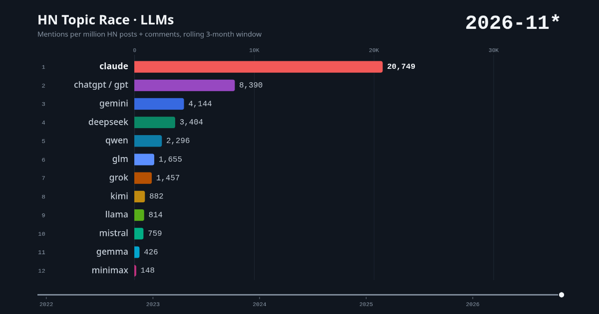

# HN Topic Bar Chart Race

A bar chart race of what Hacker News talks about: mentions per million posts and comments, month by month, over five years.

**[Open the live page](https://iantpe.github.io/hn-topic-race/)**

[](https://iantpe.github.io/hn-topic-race/)

**Needs Chrome 157 or later.** Every term, number and bar is live HTML drawn into one `<canvas>` with [HTML-in-Canvas](https://github.com/WICG/html-in-canvas). That gives one picture two things that used to exclude each other:

- It behaves like HTML: drag the timeline (a native `<input type="range">`), click a term to read that month's HN threads, select a number, press Ctrl+F, tab through the rows, use a screen reader.
- It behaves like a canvas: `captureStream()` records the same pixels, CSS gradients and glow included, straight to a video.

Other browsers show a short explanation instead of the chart, with links to the [Firefox](https://github.com/mozilla/standards-positions/issues/1076) and [Safari](https://github.com/WebKit/standards-positions/issues/630) discussions. There is deliberately no fallback renderer.

One HTML file. No backend, no build step, no external scripts or fonts. Opening the page makes no network requests: the eight preset categories play from a snapshot embedded in the file.

- **Three long races**: programming languages since 2007 (Lisp leads first, Rust passes Python in 2026), tech waves since 2007 (Rails, iPhone, Android, Bitcoin, ChatGPT, LLMs), and skills in "Who is hiring?" posts since 2012. A caption, also HTML in the canvas, marks every new #1. All embedded.
- **Compare your own terms**: up to 15, counted live through the [HN Search API](https://hn.algolia.com/api) and cached in your browser.
- **Check the numbers**: "Spot-check hits" lists the HN items behind a count, with links.
- **Fixed or dynamic axis**: one scale for the whole period by default; turn on Dynamic axis and the scale follows the leaders.
- **Share a link**: the address follows the chart. See [Links](#links).
- **Export a video**: 1920×1080 on desktop, portrait on phones.
- English and Traditional Chinese; follows your light/dark setting.

## Run it

Open `index.html` in Chrome 157 or later. `preview.png` is only the image shown when the link is shared; the page does not load it.

## Links

| Parameter | Meaning |
|---|---|
| `cat=langHist` | a preset: `model`, `ai`, `lang`, `db`, `frontend`, `editor`, `cloud`, `infra`, `langHist`, `waveHist`, `hireHist` |
| `terms=rust,zig&m=60&w=3` | your own terms, months, rolling window. Nothing is fetched until the reader presses "Fetch data" |
| `view=3d` | open in 3D |
| `axis=dynamic` | dynamic axis |

Example: [Languages since 2007, in 3D](https://iantpe.github.io/hn-topic-race/?cat=langHist&view=3d).

## How the drawing works

1. `<canvas content="drawable">` lays out its children. Each row is an `<li drawable>` with a link, a bar and a value.
2. `render()` runs in `requestAnimationFrame` and only updates the DOM: text, a `--len` custom property, and the row order (`moveBefore()`, so focus and selection survive a rank change).
3. The `paint` event draws grid lines with plain Canvas 2D, then every element with `drawElementImage()`. The browser keeps hit testing and accessibility positions in sync.
4. A `ResizeObserver` on `device-pixel-content-box` keeps the canvas grid at one pixel per device pixel. While recording, the grid is fixed at 1920×1080.

### 3D

The **3D** switch moves the same elements to a second, WebGL 2 canvas with `moveBefore()`, so focus and selection survive, and turns the camera. There is no 3D library.

- Each row is uploaded with `texElementSubImage2D()`, only when it is in the paint event's `changedElements`.
- The matrix that draws a row is also passed to `updateElementGeometry()`, perspective included. Links, text selection, find-in-page and the screen reader follow the tilt.
- The front of each bar is still its CSS; WebGL adds the sides, a highlight and shadows on the wall behind.
- Drag empty space, or focus the chart and use the arrow keys, to rotate; double-click or press 0 to reset. You can rotate while recording.

2D stays the default because perspective makes lengths harder to compare.

## How mentions are counted

- Every value is a share: items mentioning the term ÷ all posts and comments, over a rolling window. Growth of HN itself cancels out.
- For large result sets the API returns an estimate (`exhaustiveNbHits=false`). An empty query over one month reported 136,281 items; the real count was 358,184. Totals therefore come from a query with `facets=_tags`, and terms are sent as quoted phrases.
- Only titles and text are matched, not usernames or URLs.
- Terms such as `chatgpt / gpt` are document unions, so an item that mentions both counts once.
- Failed months are dropped from both numerator and denominator, so they cannot create a fake spike.

The page's Methodology section has the details, including which ambiguous terms were left out of the presets.

## Refresh the snapshot

```sh
npm run snapshot
```

This runs the page's own counting code under Node (22 or newer) and rewrites only the block between `SNAPSHOT:BEGIN` and `SNAPSHOT:END` in `index.html`. A first run sends about 6,450 requests and takes about 15 minutes; the API allows 10,000 requests per hour per IP. Finished months are cached in `scripts/snapshot.cache.json` for 30 days. If any request fails, nothing is written; run it again to fill the gaps.

The long races have their own command. It sends a few SQL queries to [ClickHouse's public Hacker News dataset](https://clickhouse.com/docs/getting-started/playground), takes seconds, and rewrites only the `HISTORY` block. The page itself never contacts ClickHouse.

```sh
npm run history
```

Then run `npm run preview` to redraw `preview.png` from the new data.

## Tests

```sh
npm install
npm test
```

Needs Google Chrome 157 or later, or set `CHROME_PATH`. `CHROME_ARGS` adds browser flags, for example `--use-angle=gl-egl --ignore-gpu-blocklist` to test on a real GPU. Takes about four minutes. All API calls are mocked.

## Credits

Inspired by [hackernewstrends.com](https://hackernewstrends.com/). Data from the HN Search API by Algolia. Not affiliated with Hacker News or Y Combinator.

## License

[MIT](LICENSE)
